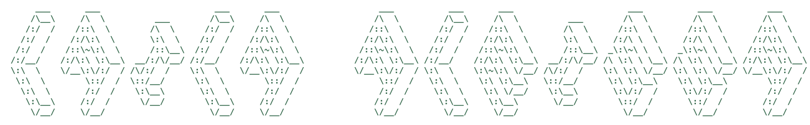

  

  

  

<h2 align="center">𝕥𝕖𝕔𝕙 𝕤𝕥𝕒𝕔𝕜 </h2>

<table bgcolor="#35694C" cellpadding="3" cellspacing="0"><tr><td>
<table bgcolor="#1e2432" cellpadding="10" cellspacing="0" width="100%">
<tr>
<td width="50%" align="center" valign="top">

  
&nbsp;&nbsp;
&nbsp;&nbsp;

</td>
<td width="50%" align="center" valign="top">

  
&nbsp;&nbsp;
&nbsp;&nbsp;
&nbsp;&nbsp;

</td>
</tr>
<tr>
<td width="50%" align="center" valign="top">

  
&nbsp;&nbsp;
&nbsp;&nbsp;

</td>
<td width="50%" align="center" valign="top">

  
&nbsp;&nbsp;
&nbsp;&nbsp;
&nbsp;&nbsp;
&nbsp;&nbsp;
&nbsp;&nbsp;
&nbsp;&nbsp;
&nbsp;&nbsp;

</td>
</tr>
</table>
</td></tr></table>

<h2 align="center">𝕤𝕥𝕒𝕥𝕤 </h2>

  

<h2 align="center">𝕔𝕠𝕟𝕟𝕖𝕔𝕥 </h2>

  &nbsp;&nbsp;
  &nbsp;&nbsp;
  &nbsp;&nbsp;

<picture>
  <source media="(prefers-color-scheme: dark)" srcset="https://raw.githubusercontent.com/lailien3/lailien3/main/dist/pet.svg">
  <source media="(prefers-color-scheme: light)" srcset="https://raw.githubusercontent.com/lailien3/lailien3/main/dist/pet-light.svg">
  
</picture>

<h2 align="center">𝕔𝕣𝕖𝕕𝕚𝕥𝕤 </h2>

  
    🎨 custom color palette, compiled with <a href="https://coolors.co/ace1af-63b481-35694c-2b523c-ff8896-cb505f-a4303f-872429">coolors.co</a>
     
    💡 ascii name idea inspired by <a href="https://github.com/tayyabadev/tayyabadev">tayyabadev</a>'s profile (styled with <a href="http://www.figlet.org/">figlet</a>'s "isometric1" font by Kent Nassen)
     
    🌳 bonsai code by <a href="https://github.com/egorthinks">egorthinks</a> — <a href="https://github.com/egorthinks/git-bonsai">git-bonsai</a>
     
    ⌨️ typing animation by <a href="https://github.com/DenverCoder1/readme-typing-svg">readme-typing-svg</a>
     
    🏷️ badges by <a href="https://shields.io">shields.io</a>, icons by <a href="https://simpleicons.org">Simple Icons</a> and <a href="https://skillicons.dev">skillicons.dev</a>
     
    ✨ heading fonts generated with <a href="https://fsymbols.com/generators/carty/">fsymbols.com carty generator</a>
     
    🐱 github pet by <a href="https://github.com/prsdx">prsdx</a> — <a href="https://github.com/prsdx/YourTomo">YourTomo</a>
     
    🔥 streak stats by <a href="https://github.com/DenverCoder1/github-readme-streak-stats">github-readme-streak-stats</a>
  

