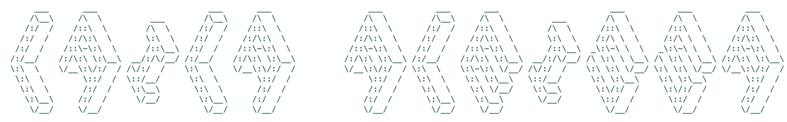

  

  

  

## 𝕥𝕖𝕔𝕙 𝕤𝕥𝕒𝕔𝕜

  &nbsp;&nbsp;
  &nbsp;&nbsp;
  

 

  &nbsp;&nbsp;
  &nbsp;&nbsp;
  &nbsp;&nbsp;
  

 

  &nbsp;&nbsp;
  &nbsp;&nbsp;
  

 

  &nbsp;&nbsp;
  &nbsp;&nbsp;
  &nbsp;&nbsp;
  &nbsp;&nbsp;
  &nbsp;&nbsp;
  &nbsp;&nbsp;
  &nbsp;&nbsp;
  

 

## 𝕤𝕥𝕒𝕥𝕤

  

## 𝕔𝕠𝕟𝕟𝕖𝕔𝕥

  
  
  

